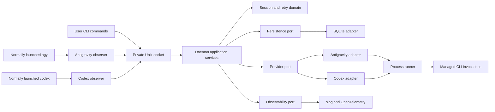
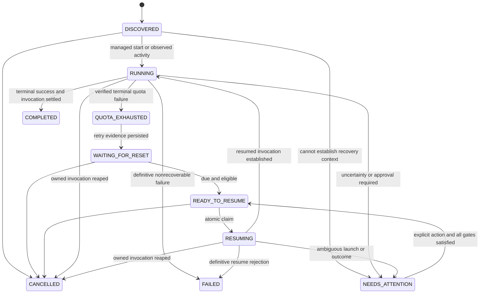
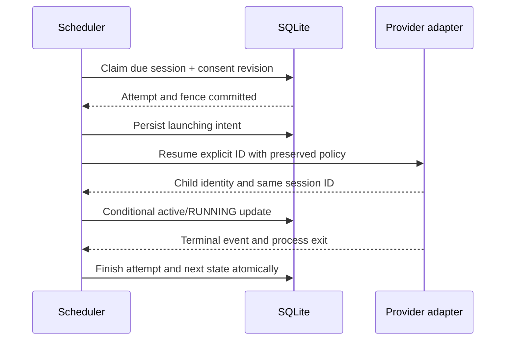

# Quota Guardian: Linux-first session supervision and recovery

Date: 2026-10-11

Status: proposed specification for user review; architectural direction approved.

Scope: design only. No application, plugin, database migration, or service is implemented.

## 1. Intent and acceptance boundary

Quota Guardian helps users continue AI coding work after legitimate usage limits renew. It must preserve session context, isolate independent sessions, survive loss of its daemon, and avoid concurrent recovery attempts. It must never invent continuation capabilities, bypass quotas, weaken provider permissions, or silently submit the original task again.

The user confirmed this is a new repository after the initial assessment found no prototype. The approved choices are Go, DDD and hexagonal boundaries, one local daemon, SQLite, provider-specific adapters, lightweight native observers, explicit autonomous-recovery consent, `slog`, and OpenTelemetry. Linux is the first supported runtime. Portable interfaces and cross-compilation do not constitute macOS or Windows runtime support.

This document defines one release design with independently verifiable milestones. It is not the implementation plan. Detailed files, RED/GREEN steps, task dependencies, and execution assignments follow only after written-spec approval.

Release acceptance requires actual tests of the implemented core and compatibility evidence for each enabled provider capability. Simulations can establish application behavior but cannot certify an external provider. Unsupported capabilities remain disabled and visible in `doctor` and session inspection.

## 2. Product modes and guarantees

| Mode | Entry point | Ownership and recovery |
| --- | --- | --- |
| Native observation | User starts `agy` or `codex` normally after official plugin installation and trust setup | Hooks report supported lifecycle metadata. Guardian does not own the interactive session and cannot infer exclusive control. |
| Managed supervision | `quota-guardian run --provider …` | Daemon owns the launched invocation and records its session ID. Eligible quota failures can enter durable waiting and subsequent recovery. |
| Explicit adoption | `sessions resume <id>` on an observed session | Requires a verified ID, preserved execution policy, and proof of exclusive safe recovery. Initial release refuses adoption where that proof is unavailable. |
| Background waiting | Managed invocation has exited after confirmed quota failure | Persisted schedule can survive terminal closure, daemon restart, and reboot. |
| Interrupted execution | Daemon disappears during start, resume, or active work | Mark `NEEDS_ATTENTION`; do not automatically replay or infer completion. |

Zero-friction means no wrapper for observation after a one-time, explicit installation. It does not mean zero configuration, retroactive discovery, guaranteed hook delivery, or autonomous recovery of all manually started sessions. The first supported hook discovers a session; sessions that emit no installed hook are invisible. No process-list scraping, private session database access, or transcript tailing is part of the initial release.

Guardian guarantees at most one Guardian-owned active attempt per session. It cannot guarantee exactly-once provider tool effects or prevent a user or another program from concurrently opening the same provider session. Autonomous eligibility requires a verified provider execution contract; uncertainty blocks recovery.

## 3. Evidence and capability gates

Evidence levels are separate fields, not interchangeable badges:

- **Local help verified:** installed binary reports a command or option; no model invocation performed.
- **Officially documented:** a fetched official page describes a contract, potentially newer than the installed binary.
- **Simulated:** a fake executable or synthetic hook fixture passes a Guardian test; none exist yet.
- **Runtime verified:** opt-in test against a named real provider version passes; none performed yet.
- **Unavailable/unverified:** adapter rejects the capability until evidence meets its gate.

Current evidence is recorded in [PROVIDER_COMPATIBILITY.md](../../PROVIDER_COMPATIBILITY.md). Installed versions are `agy 1.3.3` and `codex-cli 0.162.1`. Version-specific manifests, event schemas, quota errors, and permission behavior must be validated before release.

| Contract | Antigravity | Codex | Consequence |
| --- | --- | --- | --- |
| Structured headless stream | Help and docs: `--output-format stream-json`; documented init/result IDs | Help and docs: `exec --json`; documented thread ID | Prefer structured events; never parse assistant prose as control data. |
| Resume selected context | Help/docs: `--conversation ID` | Help/docs: `exec resume ID` | No `--continue` or `--last` for recovery. |
| Normal-launch discovery | Documented invocation hooks with conversation metadata | Documented `SessionStart` with session metadata | Observe after plugin activation; runtime contract test required. |
| Native quota observation | Documented Stop error, termination reason, idle flag | Dedicated quota failure hook not established | Antigravity parser still needs quota fixtures; Codex lifecycle observation alone is not quota detection. |
| Exclusive execution/idle proof | Not established for arbitrary manual sessions | Not established for arbitrary manual sessions | No automatic manual-session takeover. |
| Structured reset/account/window identity | Not established | Not established | Do not share cooldowns by guessed account/model scope. |
| Preserved headless permissions and completion | Not runtime verified | Not runtime verified | Automatic recovery remains gated. |

Each adapter reports capabilities independently: observe lifecycle, observe quota, structured start, resume by ID, safe autonomous resume, and quota-scope identity. An unknown version may remain observable but cannot inherit an unverified autonomous capability. Version help is necessary but insufficient; a release compatibility record includes supported versions, fixture provenance, commands exercised, and runtime results.

## 4. Architecture and bounded contexts



Three cohesive domain areas are sufficient:

1. **Session lifecycle:** session aggregate, execution ownership, consent, valid transitions, attempt identity, cancellation, and completion evidence.
2. **Quota/retry:** categorized failure, trustworthy reset evidence, scope identity, retry budget, and eligibility calculation.
3. **Recovery coordination:** application orchestration of persisted attempts and exclusive process ownership; database and OS details stay in adapters.

A task is one Guardian session aggregate, identified by a generated internal ID. Separate task/session repositories are unnecessary for the first release. Provider session IDs are opaque validated identifiers, not command text or filenames.

Proposed package responsibilities:

| Package | Responsibility |
| --- | --- |
| `cmd/quota-guardian` | CLI parsing, signal wiring, composition root |
| `internal/domain` | Pure lifecycle, quota, retry, consent rules |
| `internal/application` | Run, observe, schedule, resume, cancel, reconcile |
| `internal/ports` | Small consumer-oriented interfaces and normalized values |
| `internal/adapters/agy`, `codex` | Versioned commands, structured parsers, capability checks |
| `internal/adapters/persistence` | SQLite transactions, migrations, schema validation |
| `internal/adapters/process` | Linux child lifecycle, process groups, identity checks |
| `internal/adapters/ipc`, `hooks` | Authenticated local requests and bounded hook normalization |
| `internal/infrastructure` | Configuration, slog/OTel wiring, systemd integration |
| `plugins/agy`, `plugins/codex` | Official provider packaging and installation documentation |

Domain imports only the standard library. Application imports domain and ports, never provider adapters, SQL drivers, or OS-specific process code. Constructors receive dependencies; no global registry or service locator. The composition root registers adapters. Adding a provider requires a new adapter, registration, fixtures, and capability documentation, without changing lifecycle rules.

## 5. Ports and normalized contracts

The following are design signatures, not compiled implementation:

```go
type Provider interface {
    Name() string
    Capabilities(ctx context.Context) (Capabilities, error)
    Start(ctx context.Context, req StartRequest, emit func(Event) error) (Outcome, error)
    Resume(ctx context.Context, req ResumeRequest, emit func(Event) error) (Outcome, error)
}

type SessionStore interface {
    Create(ctx context.Context, req NewSession) (Session, error)
    Apply(ctx context.Context, change Transition) (Session, error)
    ClaimDue(ctx context.Context, req ClaimRequest) (Attempt, bool, error)
    FinishAttempt(ctx context.Context, result AttemptResult) error
    List(ctx context.Context, filter SessionFilter) ([]Session, error)
}

type Clock interface {
    Now() time.Time
    NewTimer(time.Duration) Timer
}
```

Provider methods block until their invocation is reaped; cancellation terminates the managed invocation through the runner. They emit ordered normalized events: session identified, activity, quota failure, approval required, terminal success, terminal failure. The application owns policy and state; adapters own wire formats and command construction. A failed durable event write cancels execution and prevents further scheduling.

`StartRequest` contains internal task ID, validated absolute working directory, in-memory prompt, execution policy, and attempt identity. `ResumeRequest` contains explicit provider session ID, execution context, policy, and attempt identity; it has no original prompt. Any provider-required continuation message is a fixed, disclosed instruction to continue existing work, never the original task, and is allowed only after contract verification.

`Event` contains source, provider, optional provider session ID, observed time, normalized kind, classified error, and optional verified quota scope/reset. Raw prompts, responses, and credentials are absent. An adapter may transiently read wire text to classify it; persistent errors use allowlisted codes and fixed explanations.

`Outcome` distinguishes invocation exit from provider-confirmed turn completion. Exit zero alone is insufficient. A completed turn is not a claim that the user's broader coding objective is finished.

`Transition` includes expected revision, expected state, event ID, consent revision where relevant, and typed changes. Claim and finish operations include attempt number and fencing token. Repository implementations must enforce these semantics transactionally; generic unrestricted row updates are excluded.

## 6. Lifecycle and invariants



The diagram shows principal paths; the normative transition rules follow:

- `DISCOVERED` records an observed session or a managed launch request. A start-intent attempt must be committed before launching a new process. Failures before any spawn can become `FAILED`; ambiguous starts become `NEEDS_ATTENTION`.
- `RUNNING` means active managed invocation or observed activity, distinguished by mode. Observed activity is never proof of Guardian ownership.
- `QUOTA_EXHAUSTED` records the classified failure. Its event and transition to `WAITING_FOR_RESET` normally commit in one transaction; the transition history retains both. Without safe identity/context, transition to `NEEDS_ATTENTION` instead.
- `WAITING_FOR_RESET` records a due time even when consent is disabled. Consent-disabled sessions stay waiting with an explicit blocker; time passing does not grant consent.
- `READY_TO_RESUME` means time, budget, consent, provider support, context, and ownership gates pass. A changed gate returns it to waiting or attention before any spawn.
- `RESUMING` is persisted before invoking the provider. Confirmation of the same session ID permits `RUNNING`; a different ID cancels the invocation and requires attention.
- `COMPLETED`, `FAILED`, and `CANCELLED` close a managed task. They cannot be resurrected by delayed hooks. Later manual activity on a known closed ID is recorded as an observation without reopening the task in this release.
- `NEEDS_ATTENTION` never retries automatically. Explicit resume still checks cooldown, ownership, permissions, and identity. It cannot override an unresolved active invocation.
- Cancellation from any nonterminal state first sets a durable `cancel_requested` intent and disables consent. Without an active invocation it becomes `CANCELLED` immediately. With one, cancellation completes only after termination is confirmed; unknown external activity yields attention.
- Deadline or exhausted budget yields `NEEDS_ATTENTION` with a fixed reason. Definitive authentication/configuration/invalid-session errors yield `FAILED`; permission interaction yields attention.

Invariants: one open attempt per session; matching revision/token for every attempt result; no resume without explicit ID; no schedule earlier than verified reset; no automatic retry of generic errors; no terminal success inferred from process death; observations cannot grant consent or overwrite managed execution context.

## 7. Durable data model

SQLite is owned exclusively by the daemon. Clients and hooks use IPC, never open the database. Use WAL on a local filesystem, foreign keys on every connection, `synchronous=FULL`, bounded busy timeout, explicit transactions, and versioned migrations. WAL sidecars are private state too. Network filesystems are outside the supported storage contract. SQLite durability still depends on the OS and storage honoring synchronization.

Timestamps are integer UTC epoch milliseconds. Durations are integer milliseconds with checked bounds. IDs are generated with cryptographic randomness. Database names below describe the required logical schema; migration SQL belongs to implementation.

| Table | Columns and constraints |
| --- | --- |
| `schema_migrations` | `version` PK, checksum, applied time; refuse unknown newer schema |
| `sessions` | `id` PK; nullable submission_key UNIQUE; provider; nullable provider_session_id; provider_context_id; mode CHECK(managed, observed); state CHECK(lifecycle enum); revision; fence_counter; cwd; context_json; context_digest; provider_version; last_observed_at; retry_count >= 0; retry_policy_json; next_retry_at; deadline_at; max_retries; cancel_requested; last_error_category/code; recovery_result; created_at; updated_at |
| `consents` | session_id PK/FK; enabled; revision; approved_context_digest; approved_at; revoked_at; origin CHECK(user_cli); background_allowed; no hook origin |
| `attempts` | id PK; session_id FK; attempt_number; kind CHECK(start,resume); phase CHECK(claimed,launching,active,finished,uncertain); owner_epoch; fence; lease_until; boot_id; pid; process_start_ticks; started_at; finished_at; outcome_code; UNIQUE(session_id,attempt_number) |
| `session_events` | id PK; session_id FK; dedupe_key UNIQUE; source; kind; from_state; to_state; error_code; attempt_id nullable; observed_at; received_at; no raw payload |
| `quota_windows` | scope_key PK; provider; scope_json; evidence_kind; evidence_version; reset_at; updated_at |
| `session_quota_windows` | session_id FK; scope_key FK; composite PK; records only verified membership |

Required indexes: due sessions by `(state,next_retry_at)`; events by `(session_id,received_at)`; unique provider identity `(provider,provider_context_id,provider_session_id)` when ID is non-null; partial unique attempts index on session_id where phase is claimed/launching/active/uncertain. An uncertain attempt blocks new attempts until explicitly reconciled.

`provider_context_id` distinguishes locally configured execution contexts; it is not an account identifier or quota-sharing key. `context_json` contains only an allowlisted execution contract: resolved executable, safe settings/profile references, workspace identity, supported sandbox/approval choices, and permitted environment variable names. It must exclude arbitrary argument arrays, environment snapshots, prompt content, API keys, and token-bearing configuration. A digest detects changes to the relevant nonsecret policy inputs; it does not attest secret contents or prove account identity.

The first release does not require shared quota rows: unknown scope uses the session's own next_retry_at. When verified scope becomes available, canonical scope JSON includes every dimension needed to prove membership (for example provider-issued account, model family, and window type). Several windows may apply; eligibility uses their maximum reset. Opaque identifiers may be represented by local keyed digests; hashing a guessed identity does not make it trustworthy.

Create private directories at 0700 and files at 0600 under `$XDG_STATE_HOME/quota-guardian` (default `~/.local/state/quota-guardian`). Reject unsafe ownership, symlinks at state endpoints, or shared writable paths. Do not silently repair another user's files. Migration failures stop startup. Backups use SQLite's supported backup mechanism, not a copy of the live database without its WAL. Uninstall preserves state unless deletion is explicitly requested. Default terminal-event retention is 30 days; never purge active or uncertain attempts.

## 8. Scheduling and quota classification

Adapters classify only trusted provider control fields or narrowly verified provider error messages. HTTP 429, RESOURCE_EXHAUSTED, and usage-limit text are candidates, not sufficient universal rules. Assistant messages, tool stdout, and quoted errors cannot trigger scheduling. Authentication, permission, network, service unavailable, malformed output, invalid session, and unknown failure remain distinct categories.

Reset precedence: validated structured absolute reset, validated Retry-After, provider-specific documented relative duration, then capped backoff for a confirmed quota failure with no reset. For several valid applicable constraints, use the latest eligible time. Reject overflow and ambiguous timezone/date text; record unknown timing and use backoff rather than invent a timezone. Permanent billing restrictions require attention, not infinite retry.

Proposed defaults: 30-second safety margin; fallback base 60 seconds, exponential growth capped at 1 hour; additive jitter 0–10% of fallback delay; five resume attempts; seven-day task deadline; four concurrent managed invocations. All are validated user configuration, copied into each task. Explicit provider resets are never shortened by the fallback cap. If a reset exceeds the deadline, require attention. First fallback retry uses the base, with growth by prior resume count. RNG and clock are injected for deterministic tests.

UTC deadlines persist across reboot. In-process timers use durations and recheck eligibility on wake. Recompute at most every 30 seconds to handle clock corrections; forward jumps cannot bypass other gates and backward jumps cannot cause negative-duration loops. Do not poll provider APIs during cooldown. Retry count increases atomically at resume claim, including ambiguous launches; it does not reset on repeated quota errors.

Provider/window/account/model dimensions are used only when explicit verified evidence establishes the complete scope. Unknown account context disables cross-session cooldown sharing. An execution profile name is not proof of account identity. Recovery uses the same configured provider context and never switches identities. If maintaining that context cannot be established, recovery requires attention.

## 9. Atomic claims, leases, and crash protocol

One OS advisory lock in the private state directory selects the daemon. It remains held for the daemon lifetime; no inherited lock descriptor leaks to children. A second daemon fails without modifying state or unlinking the live IPC socket. PID files are diagnostic only.

Within the daemon, SQLite write transactions (`BEGIN IMMEDIATE`) and conditional revision updates serialize claims. A claim checks due time, consent revision/digest, cancellation, budgets, supported capability, and absence of an open attempt; then inserts the attempt, increments fencing token and retry count, and moves the session to `RESUMING`. No transaction stays open while calling a provider.

Lease default: 30 seconds, renewed every 10 seconds. Leases detect lost workers, but **expiry does not authorize a replacement process**. A fenced database update cannot terminate external CLI work. The owning daemon must cancel and reap its known child before settling an expired attempt. Failed renewal stops new launches; database unavailability cancels owned work and makes health unready. A stale worker result cannot write state after its token is invalidated.



Database commit and OS process creation cannot be atomic. Both initial launch and resume therefore persist intent before spawning. A crash after intent but before recorded completion is ambiguous, even if no PID was saved. On restart, every claimed/launching/active attempt from the previous daemon epoch becomes uncertain and its session needs attention. No lease timeout converts it automatically to ready.

Startup obtains the lock, checks schema and integrity, creates a new daemon epoch, reconciles open attempts, reloads waiting schedules, then marks IPC ready. Waiting tasks with no open attempt retain their reset times and consent. Overdue eligible tasks are fairly scheduled subject to concurrency limits. Reboot invalidates old process identity; it does not prove that previously issued tool effects were absent.

For running children, Linux records PID, boot ID, and process start time; signal by a held process handle/pidfd where available, otherwise only after identity validation. Never signal a bare persisted PID. The daemon creates a process group and cancels that group, with bounded escalation. Processes that escape the group or execute through a provider's external daemon may outlive the invocation; their status requires provider-specific proof. This limitation blocks automatic retry where applicable.

Cancellation and launch share a per-session critical section. The scheduler rechecks the committed cancellation/consent state immediately before spawn. If cancellation arrives after spawn begins, it terminates the invocation; it cannot undo effects already performed. Consent revocation prevents future attempts and requests cancellation of the current automatic recovery attempt. A plain transport disconnect is not a cancellation signal.

## 10. Execution context and safe continuation

Use `exec.CommandContext` with argument slices, a resolved executable, and explicit working directory; never interpolate user strings into a shell. Provider adapters validate session ID syntax per version and prevent option injection. Record nonsecret workspace identity and approved policy settings. Missing/moved workspaces, changed policy/executable contract, unsupported versions, or changed execution context block unattended recovery.

The original prompt travels through private IPC and lives in memory only for the initial launch. Prefer provider stdin where supported. Antigravity's actual accepted prompt transport must be validated; if its print interface requires an argument, document the process-argument exposure instead of claiming stdin privacy. Do not persist a queued initial prompt. If the daemon crashes before obtaining a reliable session ID, require attention; user submission is not silently repeated.

Background process environment is deliberately smaller than the invoking shell. Use configured absolute provider paths and an allowlist of nonsecret execution settings. Providers obtain their own authentication through supported mechanisms; Guardian never reads credential files. Environment-only credentials must already be supplied by the user's service environment and cannot be copied into Guardian state or IPC requests. A setup requiring an unavailable secret environment fails visibly.

Permission parity is a release gate: prove that the selected headless start/resume path retains the user's sandbox, rules, and approval behavior. No bypass flags, approval suppression, untrusted-hook overrides, or automatic permission acceptance. If headless invocation cannot support a required approval, transition to attention with instructions for user-driven continuation. Guardian's autonomous-recovery consent is not approval for provider tool operations.

No PTY emulation, terminal keystroke injection, or private daemon API is planned. A fixed continuation prompt may create a new turn in the same session; it cannot guarantee the provider will not repeat work. That residual risk is disclosed when enabling autonomous recovery.

## 11. Native observers and installation

Each plugin invokes a small observer subcommand of the same installed binary. It reads a bounded hook payload, keeps only allowlisted metadata, normalizes the observation, sends one IPC request, and exits with the provider's verified neutral response. It neither sleeps through cooldowns nor launches recovery. It returns success on transport failure so monitoring cannot prevent normal CLI use.

Proposed bounds: 1 MiB hook input, 200 ms total delivery budget, no network calls, no disk queue, no retries on the provider's critical path. Daemon-down observations can be lost; this is explicit best-effort monitoring. A diagnostic observer command can report connectivity failures without injecting messages into agent context. Managed execution has a separate reliable event path and does not depend on hooks.

Antigravity discovery uses supported invocation metadata and Stop observations; `fullyIdle` does not prove that a user cannot start another turn. Codex discovery uses SessionStart. Lifecycle hooks may update last observation but cannot manufacture quota evidence. Codex's transcript path is not a stable parsing contract. Asynchronous delivery may reorder events; hooks never overwrite authoritative managed state or reopen terminal tasks. Natural dedupe IDs are preferred; otherwise generate delivery IDs and apply observations idempotently without inferring turn order from timestamps alone.

Install through official plugin mechanisms. Local help confirms Antigravity `plugin install/uninstall/validate` and Codex `plugin add/remove`; exact package/marketplace commands must be tested before publishing copy-paste instructions. Codex hooks require the user's trust review. No global-hook replacement, shell alias interception, or automatic edits to provider credential/configuration files. If a future supported installation needs configuration merging, it requires explicit authorization, a private backup, conflict detection, and ownership-aware removal.

Uninstall removes only the installed Guardian plugin through the provider and optionally Guardian's own service/unit/binary. Preserve other marketplace entries, plugins, trust settings, and persisted sessions. Disable active autonomous consent before removing observers/service; data deletion is a separate explicit action. Plugin installation never enables autonomous recovery.

## 12. Protected IPC and command behavior

Use HTTP over a Unix-domain socket at `$XDG_RUNTIME_DIR/quota-guardian/control.sock`, with a 0700 parent and 0600 socket. On Linux verify peer credentials match the daemon UID. Require an owner-only runtime directory; do not fall back to a predictable socket in shared `/tmp`. No TCP listener or browser endpoint in the first release.

The local same-UID boundary is intentional: an agent running as that UID may reach IPC unless its own sandbox prevents it. Guardian is not a security boundary against malicious same-user code. Provider output and observations cannot issue control commands. IPC has distinct observation and control schemas; unknown fields are rejected for controls, request bodies are capped at 1 MiB and concurrent connections at 64, and no request can supply a shell command, arbitrary executable, or persisted environment. Control requests have a 5-second admission deadline; attached output streams use separate cancellable lifetimes.

API version `/v1` exposes health, session listing/inspection, managed run, resume, cancellation, consent, and observations. Run requests use a caller-generated idempotency key; retrying after a lost response returns the existing task instead of launching again. The initial task and key are committed before responding; a lost in-memory prompt becomes attention. Hook acknowledgement occurs only after transaction commit. Busy/overloaded observers are dropped within their budget; control callers receive a clear retryable error.

Proposed user interface (not executable yet):

| Command | Contract |
| --- | --- |
| `run --provider agy|codex --prompt …` | Submit managed invocation; default recovery consent off; attach to bounded live output |
| `run … --auto-resume` | Explicit task-scoped recovery and background consent after displaying the contract |
| `sessions list`, `sessions inspect <id>` | Provider, mode, state, evidence, blockers, retry time, attempts, outcome |
| `sessions resume <id>` | Request one safe resume; never bypass known cooldown or ownership checks |
| `sessions cancel <id>` | Durable cancellation intent; report pending until owned work is reaped |
| `sessions auto-resume <id> --enable|--disable` | Explicit consent change bound to verified execution context |
| `daemon run` | Foreground service process for systemd or development |
| `daemon start|stop|status` | Control the installed user service; no privileged fallback |
| `status` | Health plus active/waiting/attention counts |
| `doctor` | Version/capability, socket, state permissions, service, and configuration checks; no model calls |

Closed attachment does not stop an authorized managed invocation. Ctrl-C sends an explicit cancel request. A daemon disconnect reports uncertain connectivity rather than resubmitting a task. Output streams are ephemeral with bounded buffers; slow clients cannot block the provider or daemon, and dropped display output is reported. Raw provider output is not stored or sent to telemetry.

## 13. systemd lifecycle and operational health

The supported background deployment is a `systemd --user` service. Installation is an explicit user command with a preview of the owned unit path. Use an absolute executable path, `Type=notify`, `Restart=on-failure`, `RestartSec=5s`, `WatchdogSec=30s`, `TimeoutStopSec=30s`, `KillMode=control-group`, and `UMask=0077`. A 10-second watchdog notification is emitted only while scheduling and storage progress checks remain healthy. The ready notification follows reconciliation and socket readiness. Validate these directives against the Linux target during implementation.

SIGTERM stops admissions and scheduling, persists shutdown intent, cancels and reaps owned processes with a 10-second grace and subsequent forced termination budget, flushes telemetry with a 2-second cap, closes IPC/database, and releases the lock. Waiting sessions survive. Interrupted active sessions become attention. systemd's final cgroup cleanup helps with owned descendants but cannot stop work dispatched to an external provider daemon. Explicit service stop does not restart automatically.

Enable the unit for the user manager's default target. Without lingering, startup after reboot can depend on user login, and logout may stop the user manager. Continuous operation before login requires an explicit user/admin decision to enable lingering; the installer never invokes privileged changes silently. Credentials and working directories must be available at recovery time.

Health reports daemon epoch/version, schema version, readiness, last successful scheduler/storage check, pending migrations, and provider capability summaries. Startup integrity/storage failure prevents readiness; sustained internal failure causes a nonzero exit for service restart, subject to systemd start-rate limits. Provider authentication outages degrade affected sessions, not the whole daemon. No aggressive retry loop on corrupt state or repeated startup failure.

Development foreground mode supports scheduling tests but does not promise all systemd descendant cleanup guarantees. macOS launchd and Windows service/process adapters remain future work with separate lifecycle tests.

## 14. Observability and privacy

Use structured `slog` records for state changes, scheduler decisions, consent changes, and categorized outcomes. Session/attempt IDs may appear in private logs but never metric attributes. Do not log raw commands, prompt bodies, outputs, hooks, credential errors, or environment values. Error categories map to fixed user-readable summaries. Paths are omitted from exported telemetry.

OpenTelemetry spans cover observe, claim, launch/resume, settle, and reconcile; do not hold a span open for a multi-hour wait. Link an attempt to its triggering observation when available. Metrics: quota exhaustions, resume attempts/successes/failures, active/waiting gauges, wait-duration histogram, and observer drops. Bounded attributes: provider from the configured allowlist, mode, state, outcome/category. No account/model/session IDs, timestamps, or arbitrary provider text as labels.

Export is disabled by default and explicitly configured through standard OTel mechanisms. Export errors never block lifecycle transactions. Queue and shutdown bounds prevent telemetry from exhausting memory or delaying termination. Status views show next retry/blocker even without an exporter. Recovery success is counted only on confirmed successful completion of the resumed invocation, not on process creation.

## 15. Failure scenarios

| Scenario | Required result |
| --- | --- |
| Quota with valid reset | Persist reset plus margin; resume only when all gates pass |
| Confirmed quota without reset | Bounded fallback, jitter, attempt budget, deadline |
| Quoted 429 in tool/model text | No quota transition |
| Auth failure or invalid session ID | Definitive failure; no quota retry |
| Permission prompt unsupported in headless mode | Attention; preserve policy |
| Waiting daemon crashes/reboots | Restore schedule and consent; no duplicate claim |
| Crash around spawn or after tool execution | Uncertain attempt blocks recovery |
| Provider emits different resumed ID | Cancel owned process; attention |
| Database full/locked/unavailable | No unpersisted launch; stop admissions, cancel affected owned work |
| PID reused or boot changed | Never signal based on old PID alone |
| Hook duplicate, stale, oversized, or malformed | Reject/drop safely; no managed-state regression |
| Manual CLI stays open after Stop | Observe only; no assumed takeover |
| Consent revoked while waiting/launching | Block launch or cancel in-flight automatic attempt |
| User opens managed session elsewhere | External concurrency is outside Guardian locking; fail safe when detected, disclose residual risk |
| Unknown provider version or schema drift | Disable affected recovery capability, show doctor warning |
| Network error during attempt | Categorize separately; no automatic quota retry without quota evidence |
| Reset later than deadline | Attention instead of early retry |
| Two accounts/models with unknown scope | Independent schedules, never provider-wide guessed cooldown |
| IPC response lost after managed submission | Same idempotency key returns same task |

## 16. Test and verification strategy

No application tests exist yet. The baseline test command failed because there was no Go module. Design verification does not count as implementation verification.

Implementation follows RED-GREEN-REFACTOR, then formatting, static checks, focused tests, and review at each milestone. Fake clock/timers and deterministic RNG avoid long real sleeps. Fake provider executables should be Go test helpers for reproducibility, with isolated HOME/state/runtime directories and no real credentials.

| Area | Required verification |
| --- | --- |
| Domain | All legal/illegal transitions, consent/cancellation races, budgets/deadlines, terminal immutability |
| Parsers | Table-driven positive/negative fixtures, malformed JSON, bounds/overflow, timezone ambiguity, model/tool quoted errors, fuzzing |
| Provider contracts | Exact argv/stdin, cwd/policy preservation, session identity, success/failed/approval events, unsupported resume |
| Persistence | Migrations, transaction rollback, conditional revisions, unique open attempt, disk failures, private permissions |
| Scheduler | Concurrent independent sessions, fair capacity, scoped cooldown isolation, multiple windows, clock jumps, no busy loops |
| Crash recovery | Kill subprocess at claim, launch intent, spawn, identity write, exit-before-commit; waiting restores and active uncertainty blocks |
| Cancellation | Before claim, during spawn, during cooldown, while emitting output, stale PID and process descendants |
| Hooks | Provider-specific schema, neutral output, trust/install fixtures, duplicates/reordering, daemon down, delivery deadline |
| IPC/CLI | Peer UID, socket permissions, oversized bodies, idempotency, status/cancel/consent, no prompt retention |
| systemd | Disposable user environment: readiness, watchdog, graceful stop, restart, login/lingering distinction, cgroup cleanup |
| Telemetry/security | Bounded labels, redaction fixtures, disabled export, output backpressure, no bypass flags |

Fake scenarios cover successful completion, quota with/without timing, interruptions, invalid IDs, missing resume support, restart while waiting, repeated errors, concurrent sessions, and authentication failures for both providers. Run `go test ./...`, `go test -race ./...`, `go vet ./...`, formatting checks, and builds once the module exists. Integration and race results must name OS and toolchain. Cross-build success is reported separately from runtime support.

Real-provider tests are separate, opt-in, and require user authorization for model usage. Prefer harmless temporary workspaces and sanitized fixtures. Do not deliberately exhaust quota. Naturally obtained authorized error fixtures may validate parsers; absence of real reset/resume evidence leaves that capability experimental or disabled. Install/uninstall tests must prove unrelated configuration survives.

## 17. Implementation milestones and release boundary

| Milestone | Dependencies | Acceptance outcome |
| --- | --- | --- |
| 1. Core and store | Approved spec and subsequent plan | Pure lifecycle/retry rules; SQLite transactional invariants and restart tests |
| 2. Managed runner and IPC | 1 | Fake providers supervised safely; bounded output, cancellation, request idempotency, no prompt persistence |
| 3. Provider contracts | 2, compatibility evidence | Both adapters parse verified formats; unsupported behavior rejected; explicit capability matrix |
| 4. Scheduler and daemon | 1–3 | Concurrent schedules, consent, leases/fencing, crash uncertainty, systemd lifecycle tests |
| 5. Native packages | 3–4, official package validation | Normal-launch discovery, best-effort observation, preserving install/uninstall |
| 6. Operational hardening | 1–5 | OTel/slog, diagnostics, security review, race tests and failure injection |
| 7. Release preparation | 1–6 | CI, versioned artifacts/checksums, changelog, installation/security/testing/configuration docs, explicit supported-platform record |

Independent parser/fixture work may be delegated after plan approval, with explicit file ownership and integration review. No delegation or implementation is authorized by this specification alone. Meaningful verified changes use Conventional Commits on an isolated development branch/worktree once there is a base commit.

The documentation set will include README, AGENTS, architecture, compatibility, implementation plan, installation, configuration, security, testing, and roadmap, plus separate plugin guides. Unsupported manual takeover and uncertain-crash recovery remain explicit even if all simulated tests pass. No production-readiness claim follows solely from mocks.

## 18. Decisions, alternatives, and review checklist

Selected single-writer daemon and SQLite over independent supervisor writers because claims, consent, events, and schedules need one atomic authority. SQLite and OpenTelemetry justify dependencies; avoid additional frameworks. Driver selection and pinning require a maintained-driver/platform evaluation during planning, without changing the storage contract. Native-only recovery was rejected because observation cannot establish durable execution ownership.

Conservative restart reconciliation trades some automatic continuation for avoiding duplicate side effects. Best-effort hooks trade offline event durability for low overhead and no extra writable queue. Native observation remains useful even when autonomous takeover is unavailable.

Self-review checks: requirements mapped to sections; provider evidence distinguished from promises; no arbitrary quota grouping; leases not mistaken for process exclusion; consent separate from permissions; spawn crash window explicit; data sensitivity bounded; all unsupported paths have a defined failure state. User review must confirm the new behavioral choices: interrupted active attempts need attention, native observation is best effort, and explicit consent is task-scoped.

Approval of this written specification authorizes the `writing-plans` stage only. Implementation requires review of that plan and selection of its execution method.

## 19. Sources

Read on 2026-10-11; provider documentation is rolling and not proof of installed-version runtime behavior.

- [Antigravity headless execution](https://www.antigravity.google/docs/cli/headless/): structured output and explicit conversation continuation.
- [Antigravity hooks](https://www.antigravity.google/docs/hooks/): invocation/Stop metadata and plugin hook locations.
- [Antigravity plugins](https://www.antigravity.google/docs/plugins?tab=cli): official extension packaging entry point.
- [Codex non-interactive mode](https://learn.chatgpt.com/docs/non-interactive-mode): structured execution and session continuation.
- [Codex hooks](https://learn.chatgpt.com/docs/hooks): discovery metadata, asynchronous limitations, transcript instability.
- [OpenAI plugin packaging](https://developers.openai.com/plugins/build/plugins): plugin hooks and user trust.
- [SQLite pragmas](https://sqlite.org/pragma.html): durability settings; database policy here is a design choice.
- Local installed `man systemd.service` inspected for service types and lifecycle semantics; proposed unit requires implementation-time validation.

Local help inspected: `agy --version`, `agy --help`, `agy plugin --help`, `codex --version`, `codex --help`, `codex exec --help`, `codex exec resume --help`, and `codex plugin --help`. No model turn, plugin installation, service change, or privilege modification was performed.
